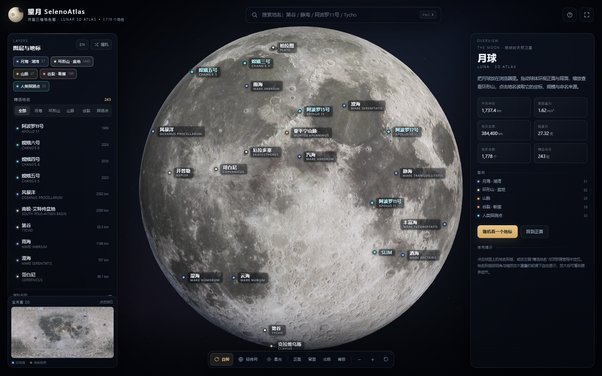

# 望月 SelenoAtlas

> **月面三维地名图 · Lunar 3D Atlas**  
> 中文名：**望月** · 英文名：**SelenoAtlas**  
> 把月球装进 Android 手机的三维地名图集。

[](https://github.com/excessiverain/seleno-atlas/actions/workflows/android-release.yml)

**下载 APK**：<https://github.com/excessiverain/seleno-atlas/releases/latest>

当前版本：**v1.2.0** · Android 8.0+（minSdk 26）· 竖屏 · 约 4.2 MB


---

## 功能

- 三维月球球体：4K 彩色月面纹理 + 4K LRO/LOLA 高程纹理，真实月面起伏与凹凸
- **1,778 个地名要素**，其中 243 个精选地名在球面上自动避让标注
- 月海/湖、环形山/盆地、山脉、月谷/月溪/断崖/山脊、33 个人类探测点
- 中文名 / 拉丁名 / 旧译名 / 任务名搜索
- **中英双语界面**：自动跟随系统语言，可在左侧面板一键切换中文 / English；英文模式使用英文地名、英文类型与英文说明，中文地名作为副标签保留
- 点击地名查看坐标、直径、命名来源、任务摘要
- 正面 / 背面 / 北极 / 南极、自动旋转、经纬网、柔光/真实日照
- 全月 2D 小地图，点击跳转
- **完全离线**：纹理、地名、Three.js 全部打包在 APK 内，**不申请 INTERNET 权限**
- 手机视口自动降低球体分段数；退出应用后释放 WebView

## 语言 / Language

- 首次启动跟随系统语言：中文系统显示中文，英文系统显示 English；也可在左侧面板点击 **EN / 中** 随时切换，选择会记忆到下一次启动。
- 英文界面下地名显示英文名，中文名作为副标签保留；搜索同时支持英文、中文和任务名。
- 英文界面的命名来源区域保留原始中文资料，并标注 `(CHINESE SOURCE)`；UI、类型、任务信息和操作提示均已英文化。

| 中文界面 | English UI |
|---|---|
|  |  |

## 安装

1. 打开 <https://github.com/excessiverain/seleno-atlas/releases/latest>；
2. 下载 `SelenoAtlas-v1.2.0.apk`；
3. Android 手机如提示“禁止安装未知应用”，在系统设置中允许当前浏览器/文件管理器安装；
4. 安装后打开「望月 SelenoAtlas」。

> **从旧版升级**：v1.1.0 / v1.2.0 使用新的 `applicationId`（`com.excessiverain.selenoatlas`），属于新应用，不能覆盖安装 v1.0.0。请先卸载旧的「月面三维地名图」，再安装望月 SelenoAtlas。

v1.2.0 的 APK 大小和 SHA-256 以 Release 页面与实际构建产物为准；Release 中同时提供 `.sha256` 文件。

> 该 APK 使用 Android **debug 签名**，仅用于个人侧载。由于 debug 签名在不同构建机/环境下可能不同，跨版本覆盖安装若提示签名冲突，请先卸载再安装。  
> 如需长期稳定升级，请使用自己的 release keystore 重新签名。

## 权限

**无。** 应用不申请网络、存储、定位、相机、麦克风等任何权限。

- 点开详情里的「嫦娥二号地图」外链时，会交给系统浏览器打开；
- 应用本身不联网，也不收集任何数据。

## 环境要求

| 项目 | 要求 |
|---|---|
| Android | 8.0（API 26）及以上 |
| WebView | 推荐系统 Chrome/WebView 较新版本（可运行 WebGL） |
| 内存 | 4 GB RAM 以上建议使用 4K 纹理版；3 GB 及以下设备如有卡顿可自行降级纹理构建 |
| 屏幕 | 竖屏手机；430×860 已验证，360×800 建议真机确认 |
| 存储 | APK 约 4.2 MB，安装后约 10–15 MB |

## 从源码构建

仓库结构：

```text
.
├─ .github/workflows/android-release.yml   # tag 触发构建并自动发布 Release
├─ android/                                # 原生 WebView 壳（Java，无第三方依赖）
│  ├─ app/src/main/java/.../MainActivity.java
│  ├─ app/src/main/assets/                 # 构建时由 Gradle 从 ../web 复制
│  └─ app/src/main/res/                    # 图标 / 主题 / 字符串
├─ web/                                    # 单文件 Web 版与源码
│  ├─ moon_atlas.html
│  ├─ src/ data/ textures/ vendor/ build/
│  └─ data/reference/
├─ docs/qa_label_audit.md
├─ screenshots/
└─ README.md
```

### 本地构建（需要 Android SDK + JDK 17）

```bash
# 在仓库根目录
cd android
gradle assembleRelease
# 产物：android/app/build/outputs/apk/release/app-release.apk
```

`android/app/build.gradle` 中的 `copyWebAsset` 任务会自动把 `web/moon_atlas.html` 复制到 `app/src/main/assets/`，无需在仓库里重复提交 6 MB 的 asset 副本。

### 发布新版本

```bash
git tag v1.2.1
git push origin v1.2.1
```

推送 tag 后，GitHub Actions 会：

1. 安装 JDK 17 / Android SDK 34；
2. 构建 `assembleRelease`；
3. 生成 `SelenoAtlas-v1.2.1.apk` 与 `.sha256`；
4. 自动创建 GitHub Release 并上传 APK。

也可在 Actions 页面手动运行 `workflow_dispatch`（只生成 artifact，不创建 Release）。

## 技术实现

- 原生壳：单 `Activity` + 全屏 `WebView`，加载 `file:///android_asset/moon_atlas.html`
- Web 页面：Three.js r128，单文件离线，无 CDN、无后端
- 外链：`http(s)` 通过 `JavascriptInterface` 交给系统浏览器
- 返回键：WebView 有历史时后退，否则退出
- 屏幕方向：锁定竖屏；状态栏/导航栏黑色，不强制 edge-to-edge
- 签名：release 构建复用 Android debug keystore，便于本地安装

## 数据与影像来源

- 地名：嫦娥二号月球地图（greensea）／IAU-USGS Gazetteer／中国天文学会天文学名词数据库
- 彩色月面纹理：Solar System Scope Moon texture（基于 NASA LRO 影像）
- 高程：LRO LOLA / WAC GLD100 高程镜像（Jaanga heightmaps）
- 三维引擎：Three.js r128
- 交互参考：[嫦娥二号月球地图](https://ce2.greensea.org/)

独立地名审校报告见 [docs/qa_label_audit.md](docs/qa_label_audit.md)：修正了莫斯科海、界海、南极-艾特肯盆地等 7 处显著坐标错误，并对差异较大的大型地貌采用 IAU LOLA 2011 坐标。

## 已知限制

- 4K 纹理在低端设备上可能有显存压力；如遇闪退可构建 2K 纹理版本。
- 页面为竖屏优化，横屏/平板布局未专门适配。
- 地图为科普可视化，不是测绘级 GIS；着陆点坐标为任务公布值/IAU 命名点。
- 外链需要在系统浏览器中联网查看，应用本身离线。
- debug 签名仅适合个人侧载，不适合正式分发。

## License / Attribution

本项目是个人学习与科普用途的本地应用。Web 端代码与 Android 壳代码可自由修改使用；**第三方纹理、地名数据与参考站内容遵循其各自来源的许可与署名要求**，详见 [docs/qa_label_audit.md](docs/qa_label_audit.md) 与 Web 应用内“关于”页。若再分发，请保留上述来源署名。
