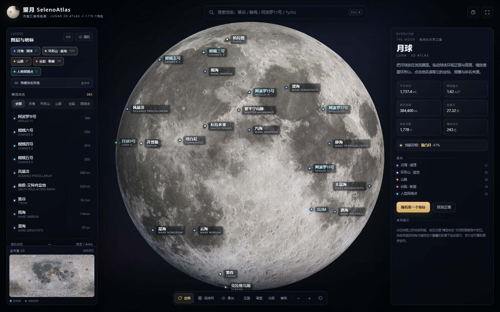
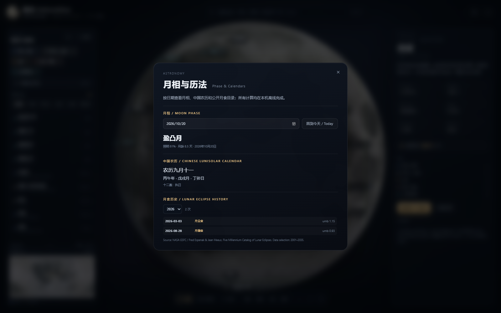
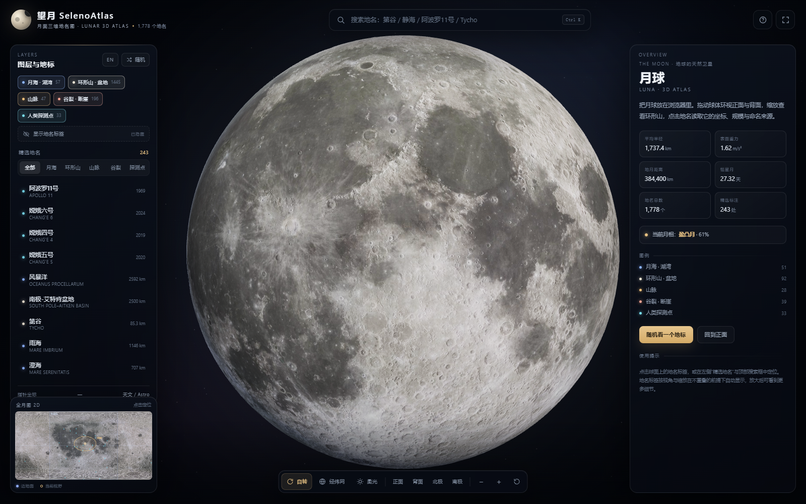
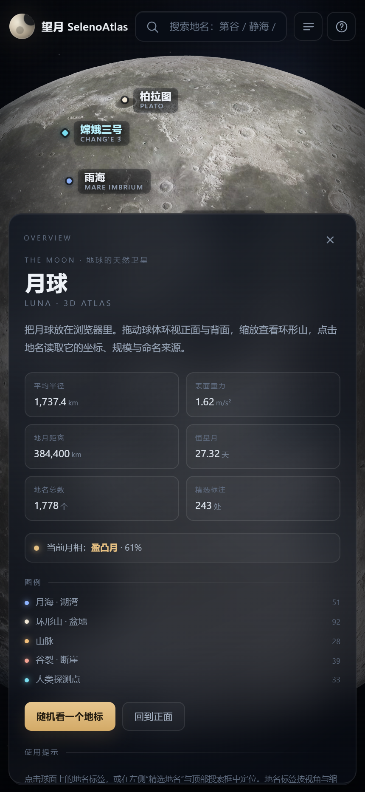
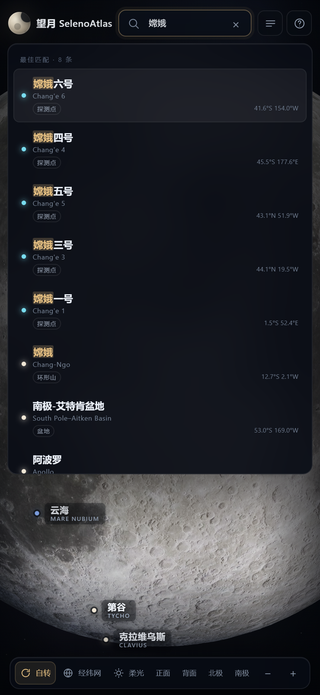

# 望月 SelenoAtlas

> **月面三维地名图 · Lunar 3D Atlas**  
> 把月球装进 Android 手机的三维地名图集，完全离线。

[](https://github.com/excessiverain/seleno-atlas/actions/workflows/android-release.yml)
[](LICENSE)

**下载稳定版 APK**：<https://github.com/excessiverain/seleno-atlas/releases/latest>

当前稳定版：**v1.5.3** · Android 8.0+（minSdk 26）· 竖屏  
APK：**4,235,638 字节（约 4.2 MB）**  
SHA-256：`4499a3cc3b5d171489fe6fee0bb096a200bde763d8e5c262089a7b60a6c56d7d`

---

## 主要功能

### 三维月面与地名

- 4K LRO 彩色月面纹理 + LRO/LOLA 高程纹理
- 1,778 个 IAU 地名，243 个精选标注自动避让
- 中文名 / 拉丁名 / 旧译名 / 任务名搜索
- 搜索框记忆最近 **12 条**搜索记录，重启后保留
- 点击地名查看坐标、直径、命名来源与任务摘要



### Overview 与天文工具

点击左上角月球图标打开 Overview，显示月面数据和当前月相。  
左侧面板底部「天文 / Astro」提供：

- 中英文月相名称、照明比例、月龄
- 按日期查看历史月相
- 中国农历传统日序（初/十/廿）
- 干支年 / 月 / 日
- 十二直
- 2001–2035 年月食历史



### 地名标签与检索

- 左侧面板独立一行「隐藏地名标签 / 显示地名标签」，一键观察裸月面
- 手机端搜索联想栏接近全屏宽度，中文/英文/类型/坐标完整显示



### 手机端

- 底部控制栏自动换行，正面 / 背面 / 北极 / 南极按钮可见
- 视角按钮再次点击可取消，恢复点选前视角
- 近距离放大时自动降低拖动灵敏度
- 左上角图标打开移动端 Overview 面板





### 双语与系统适配

- 中英文界面一键切换，选择会记忆
- 英文界面使用英文地名、类型、任务信息和说明
- Android 桌面名跟随系统语言：英文系统 **SelenoAtlas**，中文系统 **望月**
- 英文日期采用 en-SG 风格（DD MMM YYYY）

**其他功能（简短说明）**：真实日照按设备时间估算；全月 2D 小地图；经纬网；随机地名；APK 内置 MIT License、第三方声明与 AI 声明；关于页可打开 Legal 文件。

## 安装与升级

1. 打开 <https://github.com/excessiverain/seleno-atlas/releases/latest>；
2. 下载 `SelenoAtlas-v1.5.3.apk`；
3. 允许安装未知来源应用后安装。

升级规则：

- 已装 **v1.4.0 / v1.5.3**：可直接覆盖安装；
- 仍在 **v1.3.x**：旧版为临时 debug 签名，需先卸载一次；
- 旧版 v1.0.0 包名不同，需卸载旧应用。

签名从 v1.4.0 起固定为 release keystore；证书 SHA-256：

```text
E4:A1:FE:EE:DA:AD:EC:0C:BB:91:26:CF:8B:EC:2B:6C:9B:E3:D9:3E:74:5C:7D:C8:FA:C6:11:10:1F:71:3B:71
```

## 版本策略

| 版本 | 状态 |
|---|---|
| **v1.5.3** | 当前稳定 / latest |
| v1.4.0 | 上一稳定版，固定签名，可继续安装 |
| v1.5.0 / v1.5.1 / v1.5.2 | 测试版本，已删除或隐藏，不再提供 |
| v1.0.0 / v1.2.0 / v1.3.x | 历史存档，不建议升级 |

## 权限与限制

**无 Android 权限**：不申请 INTERNET、存储、定位、相机、麦克风等；全部数据离线。

- 月相/历史月相为低精度近似，边界时刻可能有数小时误差；
- 月食历史是 NASA GSFC 的 2001–2035 静态子集，不在运行时计算；
- 农历依赖 WebView 的 ICU Chinese calendar；
- 地图为科普可视化，不是测绘级 GIS。

## 数据与许可

- 地名：嫦娥二号月球地图 / IAU-USGS Gazetteer / 中国天文学会名词数据库
- 彩色纹理：Solar System Scope（CC BY 4.0，基于 NASA LRO）
- 高程：LRO LOLA / WAC GLD100
- 月食：NASA GSFC / Fred Espenak & Jean Meeus
- 引擎：Three.js r128（MIT）

**代码和文档**：MIT（见 [LICENSE](LICENSE)）。  
**第三方素材**：不纳入 MIT，见 [THIRD_PARTY_NOTICES.md](THIRD_PARTY_NOTICES.md)。  
**AI 辅助**：部分代码/UI/文档在 `deepseek-v4.1-flash-1017` 辅助下完成，经人工复核与构建测试；应用运行时不调用 AI。详见 [AI_ASSISTANCE.md](AI_ASSISTANCE.md)。

## 构建与发布

```bash
# Web 单文件
node web/build/build_html.mjs

# Android APK（需要 JDK 17 + Android SDK）
gradle -p android assembleRelease
```

推送 `v*` tag 后，GitHub Actions 使用固定 keystore 构建 APK、生成 `.sha256` 并发布 Release。  
数据审校记录：[docs/qa_label_audit.md](docs/qa_label_audit.md)
